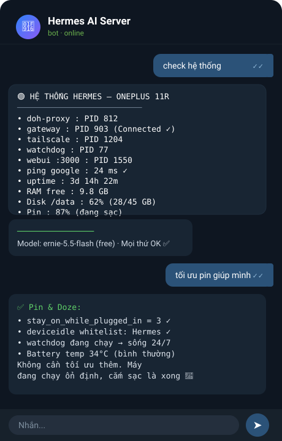

<div align="center">

# 🤖 hermes-android

### Turn your old Android into a 24/7 AI server — No VPS, Free models only

**Biến điện thoại Android cũ thành máy chủ AI chạy 24/7 — Không cần VPS, chỉ dùng model miễn phí**

[](#-quick-start)
[](#-requirements)
[](#-why-this-hits-different)
[](#-free-models-only)
[](#-demo)
[](#-license)

[🇬🇧 English](#-english) · [🇻🇳 Tiếng Việt](#-tiếng-việt)

</div>

---

## 📸 Demo

Chụp ngay từ Telegram — máy chủ AI chạy trong túi bạn, điều khiển qua tin nhắn:

<p align="center">
  
</p>

> 💡 Không có VPS. Không hóa đơn hàng tháng. Chỉ một chiếc điện thoại cũ + Telegram.

---

## ⚡ Quick Start

**Yêu cầu duy nhất:** Android 12+ đã root Magisk (hoặc Termux), cắm sạc, có Wi-Fi.

```sh
curl -sSL https://raw.githubusercontent.com/shiba-108/hermes-android/main/install.sh | bash
```

Chạy xong → reboot → mở Telegram → nhắn cho bot. Xong. 🚀

> Muốn xem trước nội dung script? `curl -sSL .../install.sh | less` trước khi chạy.

---

## 💥 Why this hits different

Một chiếc Android cũ (RAM 6GB+, còn pin chai) thừa sức chạy một AI server 24/7.
Trong khi đó VPS Lightsail/Fly.io tính tiền bạn mỗi tháng để làm đúng một việc:
chạy một process Python và giữ kết nối Telegram.

| | **VPS Lightsail** | **Android cũ (repo này)** |
|---|---|---|
| Chi phí | ~$5–10 / tháng | **$0** (điện thoại đã có) |
| Setup | 30–60 phút, firewall, systemd, OS | **1 lệnh** |
| Model | trả phí theo token (gpt-4o, claude...) | **free 100%** (ernie / ling / particle) |
| RAM | 1–2 GB | 6–12 GB (OnePlus 11R: 16GB) |
| Giữ máy | cần, dễ bị idle/kill | **cắm sạc + stayon + watchdog** |
| Sửa lỗi | SSH từ máy khác | **ngồi tại chỗ, rút sđt ra là sửa** |
| Chi phí ẩn | bandwidth, snapshot, idle | **0đ** (điện chạy sẵn) |

**TL;DR:** Android cũ = VPS miễn phí, cấu hình sẵn, không hóa đơn, không giới hạn.

---

## 🇬🇧 English

### What is this?

`hermes-android` turns a rooted Android phone into a self-healing **24/7 AI server** that runs the [Hermes Agent](https://github.com/NousResearch/hermes-agent) gateway on-device and exposes it to you through **Telegram** — no VPS, no monthly bill, running only **free-tier models**.

- 🤖 Hermes Agent gateway runs 24/7 on the phone (Magisk `service.d` + watchdog).
- 💬 Chat with it anywhere via Telegram (or a web UI over Tailscale — see [`web/`](web/)).
- 🆓 Uses only free models — see [Free models only](#-free-models-only).
- 🛡️ Survives reboots, network drops, OOM kills and Android's battery optimization.
- 📦 Everything you need is in this repo — one `curl | bash` and you're up.

### Requirements

- **Android 12+**, rooted with **Magisk** (recommended) or plain **Termux**.
- **6 GB RAM+** (8–12 GB recommended). 3 GB works but is tight.
- ~4 GB free storage, a wall charger, and Wi-Fi.
- A Telegram bot token ([BotFather](https://t.me/BotFather)) and an OpenRouter account (free).
- See [`docs/DEVICES.md`](docs/DEVICES.md) for tested devices & per-device notes.

### Quick start (1 command)

```sh
curl -sSL https://raw.githubusercontent.com/shiba-108/hermes-android/main/install.sh | bash
```

The installer is **idempotent** — safe to re-run. It backs up every file it replaces (`.bak.<timestamp>`), detects Magisk vs Termux, sets up the venv from the pinned Android lock file, installs `service.d/` scripts + skills, and runs `sh -n` on every script before finishing.

Then set your secrets once:

```sh
# ~/.hermes-home/.env  (already gitignored)
OPENROUTER_API_KEY=sk-or-...
TELEGRAM_BOT_TOKEN=123456:ABC...
```

Reboot the phone. Open Telegram, message your bot. Done.

### Free models only

This project **only** uses free-tier models. No paid keys, ever.

| Role | Model |
|---|---|
| **Default** | `baidu/ernie-5.5-flash-preview:free` |
| **Fallback 1** | `inclusionai/ling-3.2-flash:free` |
| **Fallback 2** | `particle-ai/particle-1:free` |

Set them with:

```sh
hermes config set model.default baidu/ernie-5.5-flash-preview:free
hermes config set model.provider openrouter
```

> 63-model `/model` menu cache? Clear it with `hermes config clear model_cache` (details in [`BI-KIP.md`](BI-KIP.md)).

### How it stays alive (self-healing)

- **`service.d/02-adbd.sh`** — re-enable ADB over TCP (optional, for remote access).
- **`service.d/03-nowake.sh`** — `svc power stayon true` + disable Doze, so Android never sleeps the process.
- **`service.d/04-doh.sh`** — DNS-over-HTTPS proxy + iptables NAT on :53 (unblocks Telegram/DNS).
- **`service.d/05-watchdog.sh`** — every 300s, revives doh / gateway / tailscale if they die (checks PID **and** `Connected to Telegram` in the log).
- **`service.d/hermes.sh`** — launches the gateway at boot.
- **`scripts/preflight_venv.sh`** — verifies venv against the lock, repairs on drift.

### Web UI (chat from your laptop, no laptop-on-the-go)

Prefer a browser? [`web/`](web/) runs a tiny self-hosted chat UI on port **3000** over Tailscale, started with `nohup` and kept alive by a watchdog — no `tmux` needed. See [`web/README.md`](web/README.md).

### Backups

[`scripts/backup.sh`](scripts/backup.sh) encrypts your `.env`, `auth.json`, `config.yaml` and `sessions/` into an age-encrypted archive and pushes it to a **private** repo (or Google Drive via `rclone`). It **never** pushes secrets to this public repo. See [`docs/BACKUP.md`](docs/BACKUP.md).

### Repo layout

```
hermes-android/
├── README.md              # you are here
├── BI-KIP.md              # field notes: commands, pitfalls, fixes
├── install.sh             # idempotent installer (Magisk + Termux)
├── service.d/             # Magisk boot scripts (root)
├── scripts/               # preflight_venv, backup, make_lock
├── locks/                 # pinned venv requirements (Android-safe)
├── skills/                # Hermes skills (sys-status, sys-logs, ...)
├── web/                   # self-hosted chat UI (Tailscale :3000)
└── docs/                  # DEVICES.md, BACKUP.md
```

### Contributing

PRs welcome — especially new device reports for [`docs/DEVICES.md`](docs/DEVICES.md). Keep the golden rule: **free models only, no secrets in git**.

### License

MIT — do whatever you want, no warranty. See [`LICENSE`](LICENSE).

---

## 🇻🇳 Tiếng Việt

### Đây là gì?

`hermes-android` biến một chiếc điện thoại Android đã root thành **máy chủ AI 24/7 tự phục hồi**, chạy [Hermes Agent](https://github.com/NousResearch/hermes-agent) ngay trên máy và điều khiển qua **Telegram** — không cần VPS, không hóa đơn hàng tháng, chỉ dùng **model miễn phí**.

- 🤖 Gateway Hermes chạy 24/7 trên điện thoại (Magisk `service.d` + watchdog).
- 💬 Nhắn tin với nó ở bất cứ đâu qua Telegram (hoặc web UI qua Tailscale — xem [`web/`](web/)).
- 🆓 Chỉ dùng model free — xem [Model miễn phí](#-model-miễn-phí).
- 🛡️ Sống sót qua reboot, mất mạng, bị Android kill, tối ưu pin.
- 📦 Tất cả nằm trong repo này — một lệnh `curl | bash` là chạy.

### Yêu cầu

- **Android 12+**, đã root **Magisk** (khuyến nghị) hoặc **Termux** thuần.
- **RAM 6 GB+** (khuyến nghị 8–12 GB). 3 GB chạy được nhưng chật.
- ~4 GB trống, cắm sạc, có Wi-Fi.
- Token bot Telegram ([BotFather](https://t.me/BotFather)) + tài khoản OpenRouter (free).
- Xem [`docs/DEVICES.md`](docs/DEVICES.md) để biết máy đã test và lưu ý từng dòng.

### Cài đặt (1 lệnh)

```sh
curl -sSL https://raw.githubusercontent.com/shiba-108/hermes-android/main/install.sh | bash
```

Script **idempotent** — chạy lại bao nhiêu lần cũng an toàn. Nó tự `.bak` mọi file cũ, tự nhận diện Magisk/Termux, tạo venv từ lock Android, copy `service.d/` + scripts + skills, và chạy `sh -n` kiểm tra cú pháp mọi script trước khi xong.

Sau đó khai báo secret một lần:

```sh
# ~/.hermes-home/.env  (đã được gitignore)
OPENROUTER_API_KEY=sk-or-...
TELEGRAM_BOT_TOKEN=123456:ABC...
```

Reboot máy → mở Telegram → nhắn cho bot. Xong.

### Model miễn phí

Repo này **chỉ** dùng model free. Không bao giờ dùng key trả phí.

| Vai trò | Model |
|---|---|
| **Mặc định** | `baidu/ernie-5.5-flash-preview:free` |
| **Dự phòng 1** | `inclusionai/ling-3.2-flash:free` |
| **Dự phòng 2** | `particle-ai/particle-1:free` |

Đặt bằng:

```sh
hermes config set model.default baidu/ernie-5.5-flash-preview:free
hermes config set model.provider openrouter
```

> Lỗi menu `/model` cache 63 con? Xóa cache: `hermes config clear model_cache` (chi tiết trong [`BI-KIP.md`](BI-KIP.md)).

### Cơ chế tự phục hồi

- **`02-adbd.sh`** — bật lại ADB qua TCP (tùy chọn, để truy cập từ xa).
- **`03-nowake.sh`** — `svc power stayon true` + tắt Doze, Android không bao giờ ngủ process.
- **`04-doh.sh`** — DNS-over-HTTPS + iptables NAT :53 (mở khóa Telegram/DNS).
- **`05-watchdog.sh`** — mỗi 300s hồi sinh doh / gateway / tailscale nếu chết (kiểm tra cả PID **lẫn** dòng `Connected to Telegram`).
- **`hermes.sh`** — khởi động gateway khi boot.
- **`preflight_venv.sh`** — đối chiếu venv với lock, tự sửa khi lệch.

### Web UI (chat từ laptop, không cần bật laptop)

Thích dùng trình duyệt? [`web/`](web/) chạy một web chat nhỏ ở cổng **3000** qua Tailscale, khởi động bằng `nohup` + watchdog canh — không cần `tmux`. Xem [`web/README.md`](web/README.md).

### Sao lưu

[`scripts/backup.sh`](scripts/backup.sh) mã hóa `.env`, `auth.json`, `config.yaml`, `sessions/` thành archive mã hóa age rồi đẩy lên repo **private** (hoặc Google Drive qua `rclone`). **Không bao giờ** đẩy secret lên repo public này. Xem [`docs/BACKUP.md`](docs/BACKUP.md).

### Cấu trúc repo

```
hermes-android/
├── README.md              # bạn đang đọc
├── BI-KIP.md              # bí kíp: lệnh, lỗi, cách sửa
├── install.sh             # installer idempotent (Magisk + Termux)
├── service.d/             # script boot Magisk (root)
├── scripts/               # preflight_venv, backup, make_lock
├── locks/                 # ghim requirements venv (an toàn Android)
├── skills/                # skill Hermes (sys-status, sys-logs, ...)
├── web/                   # web chat (Tailscale :3000)
└── docs/                  # DEVICES.md, BACKUP.md
```

### Đóng góp

PR hoan nghênh — nhất là báo cáo máy mới cho [`docs/DEVICES.md`](docs/DEVICES.md). Giữ nguyên tắc vàng: **model free, không secret trong git**.

### Giấy phép

MIT — dùng thoải mái, không bảo hành. Xem [`LICENSE`](LICENSE).

---

## ❓ FAQ

**Q: Điện thoại cũ có đủ khỏe không?**
Có. Chỉ cần chạy 1 process Python + giữ kết nối Telegram. RAM 6GB+ là dư; OnePlus 11R (16GB) dư sức. 3GB vẫn chạy nhưng nên chọn bản nhẹ.

**Q: Tốn điện không?**
Tương đương một bóng đèn LED nhỏ. Cắm sạc + `stayon` là xong.

**Q: Android có tự kill app không?**
`03-nowake.sh` tắt Doze/battery optimization cho Hermes, watchdog `05-watchdog.sh` hồi sinh mỗi 5 phút. Bất tử qua reboot.

**Q: Model free có đủ xài không?**
Đủ cho chat, tóm tắt, viết lách, assistant cá nhân. Không bằng GPT-4o cho code nặng, nhưng free 100% và không giới hạn token.

**Q: Làm sao truy cập từ xa?**
Qua Telegram (mọi lúc mọi nơi) hoặc web UI qua Tailscale (`web/`).

**Q: Có an toàn không? Key có bị lộ không?**
`.env`, `auth.json`, `config.yaml`, `sessions/` đều nằm trong `.gitignore`. `scripts/backup.sh` mã hóa age trước khi đẩy lên repo private.

**Q: Không root được thì sao?**
Vẫn chạy được trên Termux thuần, nhưng thiếu mấy script `service.d/` (root). Xem `install.sh` phần auto-detect.

**Q: Điện thoại mới, chưa root, làm sao bắt đầu?**
Root bằng Magisk theo `docs/DEVICES.md` cho đúng dòng máy của bạn, rồi chạy lệnh cài 1 dòng ở trên.

---

<div align="center">
  <sub>Made with ❤️ for the "one more old phone in the drawer" gang.</sub>
</div>