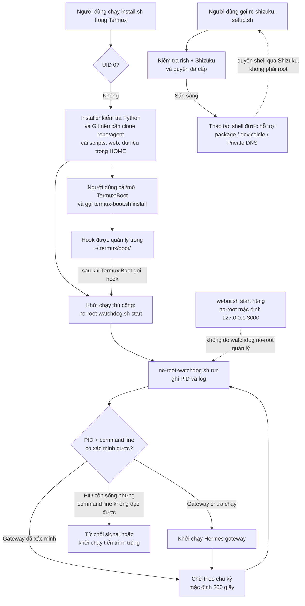
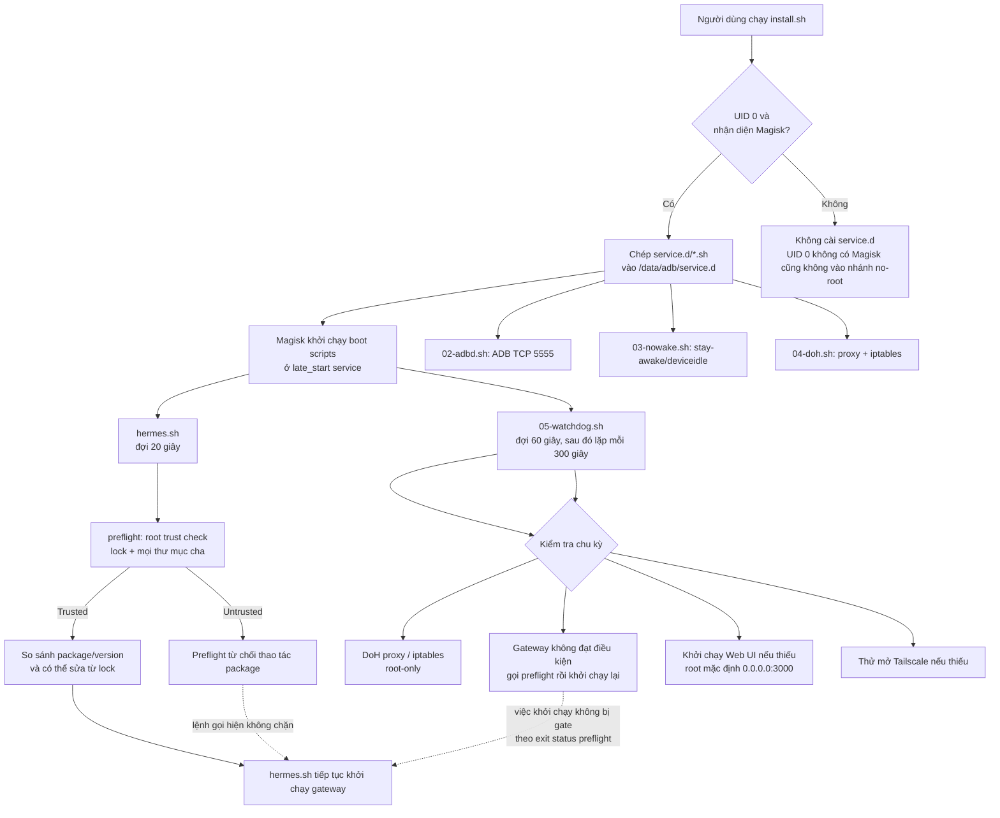

# Kiến trúc runtime Hermes Android V2

Tài liệu này mô tả code V2 tại implementation commit `e46da08a417939efe0ee667e0637f99711fa7aff` cùng follow-up `5622132f261aff804b3d798d8bab74dc038a3045` (đối chiếu diff giữa hai commit). Các thay đổi installer, preflight và Web UI bên dưới phản ánh code mới nhất ở `5622132`; luồng Termux:Boot, watchdog no-root, Shizuku helpers và `service.d` không đổi trong follow-up đó. **Mô tả code và kiểm thử Linux không đồng nghĩa với xác nhận Android runtime: Android runtime chưa được test, và không có kiểm thử trên OnePlus 11R.**

Trong tài liệu này, **no-root** là Termux chạy không có UID 0. Shizuku là cầu gọi một số lệnh ở quyền shell sau khi người dùng khởi chạy và cấp quyền; nó **không phải root**. **Magisk root** là nhánh riêng, trong đó các script `service.d` chạy với quyền mạnh hơn.

## Tóm tắt

| Thành phần | Hành vi đã có trong code | Giới hạn cần giữ rõ |
|---|---|---|
| Termux no-root | Installer cài vào thư mục người dùng; có thể chạy watchdog thủ công; Termux:Boot hook là tùy chọn và chỉ cài khi người dùng gọi lệnh. Watchdog chỉ quản lý Hermes gateway mà nó ghi nhận. | Không tự bật boot hook, không giám sát mọi dịch vụ, không kiểm tra kết nối Telegram và không bảo đảm tiến trình chạy liên tục. |
| Shizuku tùy chọn | `shizuku-setup.sh` kiểm tra `rish` rồi thực hiện một số thao tác package, deviceidle và Android Private DNS khi được gọi rõ ràng. | Không phải `su`/root, không tự chạy khi boot và không triển khai DoH/iptables. |
| Magisk root | Installer chép `service.d/*.sh` khi vừa UID 0 vừa nhận diện Magisk. Các script hiện hữu khởi chạy gateway và có watchdog đặc quyền. | Là nhánh riêng, không phải fallback của no-root hoặc Shizuku. |
| Web UI | Không có xác thực/TLS. Mặc định no-root bind `127.0.0.1`; root-mode bind `0.0.0.0`. `WEBUI_HOST` cho phép chọn tường minh; `HERMES_VENV` được dùng để tìm Python/Hermes CLI. | Web UI no-root không do watchdog no-root quản lý. Root-mode có thể lộ UI không xác thực trên các giao diện mạng. |
| Preflight venv | Root kiểm tra lock file và mọi thư mục cha về owner/mode trước khi đọc lock hoặc cài package; package/version được truyền qua argv. | Quyền và owner thực tế trên Android chưa được runtime kiểm tra. Preflight từ chối thao tác package nếu không xác lập được trust boundary. |

## V2 đã triển khai

### Cài đặt và phân nhánh quyền

[`install.sh`](../install.sh) nhận diện root từ UID 0 và nhận diện Magisk riêng. Chỉ khi **cả hai** điều kiện đúng, installer mới chép script vào `/data/adb/service.d`. Nếu không, nó bỏ qua `service.d`. Code chọn `MODE=root` theo UID 0; một môi trường UID 0 nhưng không có Magisk vẫn không được cài `service.d` và cũng không đi vào nhánh hướng dẫn `MODE=no-root`.

Ở Termux no-root, `HERMES_HOME` mặc định là `$HOME/.hermes-home`, venv là `$HOME/hermes-venv`, và mã `hermes-agent` là `$HOME/hermes-agent`; có thể ghi đè bằng biến môi trường tương ứng. Installer chép scripts và Web UI vào thư mục cài đặt, nhưng **không** cài boot hook, không tự gọi watchdog và không thay đổi package, Doze hay DNS hệ thống.

Theo follow-up `5622132`, installer kiểm tra Python trước khi ghi các file cài đặt; Git cần có nếu phải clone repo hoặc `hermes-agent`. Nếu cần clone `hermes-agent` mà không có Git thì installer dừng, và clone lỗi cũng kết thúc với trạng thái lỗi thay vì tiếp tục báo hoàn tất. Đây là fail-fast cho prerequisite/clone; lỗi tạo venv hoặc pip vẫn có thể chỉ được ghi thành cảnh báo và installer tiếp tục tới phần tổng kết, nên dòng “Xong” không tự nó chứng minh mọi package đã cài thành công.

### Termux:Boot và watchdog no-root

[`scripts/termux-boot.sh`](../scripts/termux-boot.sh) chỉ đăng ký boot hook khi người dùng gọi `install`. Hook được đặt tại `$HOME/.termux/boot/hermes-start.sh`; cấu hình đường dẫn được lưu riêng dưới dạng dữ liệu và không được `source`/`eval`. Script từ chối ghi đè hook hoặc file cấu hình không có marker quản lý của Hermes. Lệnh `uninstall` chỉ gỡ các file do Hermes quản lý; nó **không** dừng watchdog hoặc gateway đang chạy. Việc cài/mở Termux:Boot lần đầu là bước ngoài installer.

[`scripts/no-root-watchdog.sh`](../scripts/no-root-watchdog.sh) có thể được gọi thủ công bằng `start`, hoặc được hook Termux:Boot gọi sau reboot. Mặc định nó kiểm tra mỗi 300 giây (giá trị không hợp lệ hoặc nhỏ hơn 10 giây được đưa về 300). Nó xác minh PID và command line trước khi nhận diện hoặc gửi tín hiệu tới tiến trình. Nếu không đọc được command line của PID còn sống, script từ chối gửi tín hiệu hoặc khởi tạo tiến trình trùng.

Watchdog chỉ khởi chạy/giám sát Hermes gateway theo PID mà chính nó ghi nhận. Tiêu chí là danh tính tiến trình, không phải kiểm tra sức khỏe ứng dụng hay trạng thái kết nối Telegram. Nó không giám sát Web UI, Tailscale, DoH, Shizuku, package, deviceidle hay DNS; cũng không gọi `su`, `iptables`, `setprop`, `svc power` hoặc các lệnh hệ thống tương tự. `stop` gửi TERM tới các tiến trình đã xác minh; điều đó không chứng minh tiến trình đã dừng trên Android.

### Shizuku helpers (tùy chọn, chạy theo yêu cầu)

[`scripts/shizuku-setup.sh`](../scripts/shizuku-setup.sh) không được installer, boot hook hay watchdog tự gọi. Mỗi nhóm lệnh kiểm tra `rish` và thử `rish -c id`; nếu Shizuku/rish chưa sẵn sàng hoặc chưa được cấp quyền, script dừng.

- `pm show/disable/enable`: thao tác giới hạn ở package bên thứ ba được nêu chính xác; script chỉ nhận quyền hoàn tác package mà chính nó đã disable.
- `deviceidle show/add/remove`: chỉ thêm package bên thứ ba được chỉ định; chỉ gỡ mục mà script đã ghi nhận là do nó thêm. Mục có trước được giữ nguyên.
- `private-dns show/set/restore`: đặt Android Private DNS theo hostname và lưu trạng thái cũ để hoàn tác có điều kiện; nếu thấy cấu hình hiện tại đã bị thay đổi độc lập, script từ chối ghi đè.

Android Private DNS ở đây là **DNS-over-TLS (DoT), không phải DNS-over-HTTPS (DoH)**. Helpers dùng lệnh shell qua Shizuku; chúng không tạo root, không triển khai VPNService/iptables và không được tích hợp vào vòng lặp watchdog. Hỗ trợ từng lệnh phụ thuộc phiên bản Android/OEM và quyền Shizuku thực tế.

### Magisk `service.d` — luồng root riêng

Follow-up `5622132` không thay đổi nội dung `service.d/`; installer giữ luồng cũ và chỉ cài các script đó khi có cả root lẫn Magisk. Theo code hiện có:

- `service.d/hermes.sh` chờ 20 giây, gọi `preflight_venv.sh`, rồi khởi chạy `hermes gateway run`.
- `service.d/05-watchdog.sh` chờ 60 giây rồi lặp theo chu kỳ 300 giây. Nó kiểm tra/chạy lại DoH proxy và quy tắc iptables khi thiếu proxy; kiểm tra gateway theo tiến trình và tìm `Connected to Telegram` trong `/data/local/hermes-home/logs/gateway.log`; chạy lại preflight/khởi động gateway khi điều kiện không đạt; khởi chạy Web UI nếu file server tồn tại mà tiến trình không thấy; và thử mở Tailscale nếu tiến trình không thấy.
- Các helper đặc quyền hiện có còn gồm `02-adbd.sh` (bật ADB TCP 5555), `03-nowake.sh` (các lệnh stay-awake/deviceidle) và `04-doh.sh` (khởi chạy proxy rồi chuyển hướng UDP/53 bằng iptables). Đây **không** phải các hành động của nhánh no-root hay Shizuku helpers.
- Root preflight mới từ chối đọc lock/cài package nếu lock path không qua được kiểm tra tin cậy. Tuy nhiên, `hermes.sh` và watchdog hiện gọi preflight như một lệnh riêng, không dùng điều kiện để chặn lệnh khởi chạy gateway kế tiếp khi preflight trả lỗi. Vì vậy, “fail-closed” ở đây áp dụng cho thao tác package trong preflight, không đồng nghĩa `service.d` dừng toàn bộ luồng khởi động.

Một khác biệt cần giữ rõ khi đọc code: `hermes.sh` chuyển stdout/stderr gateway tới `/data/local/tmp/hermes.log`, trong khi watchdog đọc `logs/gateway.log` để tìm dòng Telegram. Code được đọc không chứng minh hai nguồn log này đồng bộ; cần kiểm chứng thực tế trước khi dựa vào điều kiện log như health check.

### Web UI

[`scripts/webui.sh`](../scripts/webui.sh) mặc định dùng cổng 3000. Wrapper chọn host mặc định theo quyền: no-root là `127.0.0.1`, root là `0.0.0.0`; `WEBUI_HOST` và `WEBUI_PORT` có thể ghi đè. Follow-up `5622132` cũng làm [`web/server.py`](../web/server.py) có mặc định tương ứng khi chạy trực tiếp: loopback khi effective UID không phải 0, `0.0.0.0` khi root. `HERMES_VENV` được wrapper dùng để chọn Python và được server dùng để tìm Hermes CLI cho `/api/send`.

Web UI được điều khiển riêng bằng `webui.sh`; watchdog no-root không tự khởi chạy hay phục hồi nó. Watchdog `service.d` root hiện hữu có thể khởi chạy lại Web UI. UI không có xác thực hoặc TLS; vì vậy tài liệu Web UI khuyến nghị giữ server bind loopback và dùng Tailscale Serve để truy cập riêng trong tailnet, với ACL/grants phù hợp. Không mở thẳng ra Internet, không dùng Tailscale Funnel nếu không chủ ý công khai dịch vụ, và không dùng wildcard `0.0.0.0` nếu chưa có lớp xác thực cùng giới hạn mạng phù hợp.

### Preflight venv và trust boundary

[`scripts/preflight_venv.sh`](../scripts/preflight_venv.sh) so sánh package trong lock với môi trường Python và cài lại từ lock nếu phát hiện sai khác. Trong follow-up `5622132`, khi chạy UID 0, script dùng `lstat` để yêu cầu lock là file thường và lock cùng **mọi thư mục cha** đều thuộc root, đồng thời mode không cho group/other ghi. Nếu kiểm tra thất bại hoặc không đọc được metadata, preflight ghi lỗi và thoát trước khi đọc lock để kiểm tra/cài package (fail-closed). Kiểm tra này chỉ áp dụng ở nhánh root; cách xử lý không-root không bị đổi bởi guard này.

Cũng trong `5622132`, tên package và version được truyền vào đoạn Python qua `sys.argv`, thay vì nội suy nội dung lock vào mã Python `-c`. Vì vậy, finding tĩnh trước đây về khả năng chạy payload từ tên package trong lock đã được xử lý trong code mới; không còn mô tả nó như blocker hiện tại. Đây vẫn là nhận định từ code: owner/mode thực trên Android chưa được runtime kiểm tra.

## Sơ đồ luồng

### Termux no-root, Termux:Boot và Shizuku

### Magisk root và `service.d`

## Đề xuất — chưa triển khai

Các mục dưới đây là hướng thiết kế, không phải hành vi V2 hiện có:

1. **Quản lý service no-root:** cân nhắc `termux-services`/runit để quản lý start/stop/status riêng cho gateway và Web UI. Watchdog V2 hiện chỉ lo gateway; không có tích hợp runit.
2. **Health check tốt hơn:** bổ sung kiểm tra đáp ứng của gateway và log/state có cấu trúc, giới hạn retry và báo lỗi rõ. Không coi process còn tồn tại là bằng chứng dịch vụ khỏe. Phần này chưa được triển khai ở watchdog no-root.
3. **Android companion app (nếu cần):** foreground service có notification thường trực, thao tác Stop/Status và quyền phù hợp có thể là lựa chọn cho tác vụ dài hạn do người dùng nhận biết; `JobScheduler` có thể dùng cho việc hữu hạn như health check hoặc khôi phục sau sự kiện mạng/sạc. Cả hai cần app Android native và chính sách theo API level; repo hiện không có companion app hay mã đăng ký `JobService`. JobScheduler không phải timer chính xác hoặc cơ chế giữ socket liên tục.
4. **Root helper hardening:** giới hạn tối đa lệnh chạy bằng root, ghi rõ thao tác đặc quyền và cách khôi phục, đồng thời xác nhận owner/mode trên thiết bị Android. Đây là khuyến nghị, không phải thay đổi trong diff V2.

## Giới hạn nền tảng và bảo mật

- **Android runtime chưa được test.** Regression harness `tests/no_root_harness.py` chạy trên Linux và hiện pass 8/8; các test gồm cú pháp shell/Python, case payload trong tên package, guard lock root không tin cậy, mặc định host, launcher/API dùng `HERMES_VENV` và một số lỗi prerequisite của installer. Đây chỉ xác minh hành vi mã/script trong harness Linux, không xác nhận boot, permission/owner/mode trên Android, quyền Shizuku, chính sách pin OEM hay tiến trình nền trên thiết bị. Không có kết quả PASS cho Android runtime.
- **Không đảm bảo uptime 24/7.** Termux:Boot cần được cài/mở và hook được đăng ký chủ động. Android/OEM vẫn có thể giới hạn nền, trì hoãn mạng hoặc dừng tiến trình; mất nguồn/mạng, OOM và nhiệt cũng nằm ngoài bảo đảm script.
- **Shizuku không phải root.** Nhánh no-root chỉ dùng quyền shell mà người dùng cấp qua Shizuku; cần khởi động/cấp quyền theo cơ chế Shizuku. Các thao tác deviceidle và Private DNS có thể khác nhau theo Android/OEM; code có nhánh lỗi nhưng chưa được xác minh trên runtime.
- **Web UI cần được giới hạn mạng.** Server không có xác thực/TLS. No-root mặc định loopback; wrapper/server root mặc định bind `0.0.0.0`. Nếu root-mode Web UI có thể truy cập từ LAN/Tailscale, người truy cập có thể gửi lệnh qua UI tới gateway. Ưu tiên loopback + Tailscale Serve với ACL/grants phù hợp; không mở cổng trực tiếp ra Internet.
- **Magisk scripts có tác động đặc quyền.** ADB TCP, thay đổi deviceidle/stay-awake và iptables là hành vi root hiện có. Không dùng chúng như fallback ngầm cho Termux no-root hoặc Shizuku.
- **Preflight lock sau `5622132`.** Việc nội suy package/version vào Python đã được thay bằng argv và root path có guard owner/mode fail-closed; đây là sửa lỗi trong code mới, không còn là blocker tĩnh như mô tả trước. Dù vậy, quyền file thực trên Android chưa được runtime kiểm tra. Ngoài ra, `service.d` hiện không kiểm tra exit status preflight trước khi chạy lệnh gateway kế tiếp; đừng hiểu fail-closed của preflight là dừng toàn bộ boot flow.

## Nguồn

### Mã nguồn trong repo

- [`install.sh`](../install.sh) — phát hiện UID/Magisk, prerequisite và điều kiện cài `service.d`.
- [`scripts/termux-boot.sh`](../scripts/termux-boot.sh) — đăng ký/gỡ hook Termux:Boot.
- [`scripts/no-root-watchdog.sh`](../scripts/no-root-watchdog.sh) — vòng giám sát gateway no-root.
- [`scripts/shizuku-setup.sh`](../scripts/shizuku-setup.sh) — helper Shizuku và hoàn tác trạng thái.
- [`scripts/preflight_venv.sh`](../scripts/preflight_venv.sh) — xác minh lock/package và guard root trust.
- [`scripts/webui.sh`](../scripts/webui.sh), [`web/server.py`](../web/server.py), [`web/README.md`](../web/README.md) — host/port, venv, bảo mật và hướng dẫn truy cập Web UI.
- [`service.d/`](../service.d/) — luồng Magisk root hiện hữu; không thay đổi trong follow-up `5622132`.
- [`tests/no_root_harness.py`](../tests/no_root_harness.py) — regression harness Linux, không phải Android runtime test.
- [`docs/NO-ROOT.md`](NO-ROOT.md) — hướng dẫn sử dụng no-root và các lệnh tùy chọn.

### Tài liệu nền tảng

- Android Developers: [Background tasks overview](https://developer.android.com/develop/background-work/background-tasks), [JobScheduler API](https://developer.android.com/reference/android/app/job/JobScheduler), [Doze and App Standby](https://developer.android.com/training/monitoring-device-state/doze-standby), [Keep the device awake](https://developer.android.com/develop/background-work/background-tasks/awake), [Foreground services overview](https://developer.android.com/develop/background-work/services/foreground-services).
- Termux: [Termux:Boot](https://github.com/termux/termux-boot) and [termux-services](https://github.com/termux/termux-services).
- Magisk: [Developer Guides — Boot Scripts](https://github.com/topjohnwu/Magisk/blob/master/docs/guides.md#boot-scripts).
- Shizuku: [Introduction](https://shizuku.rikka.app/introduction/) and [User manual: setup](https://shizuku.rikka.app/guide/setup/).
- Tailscale: [Serve](https://tailscale.com/docs/reference/tailscale-cli/serve).
