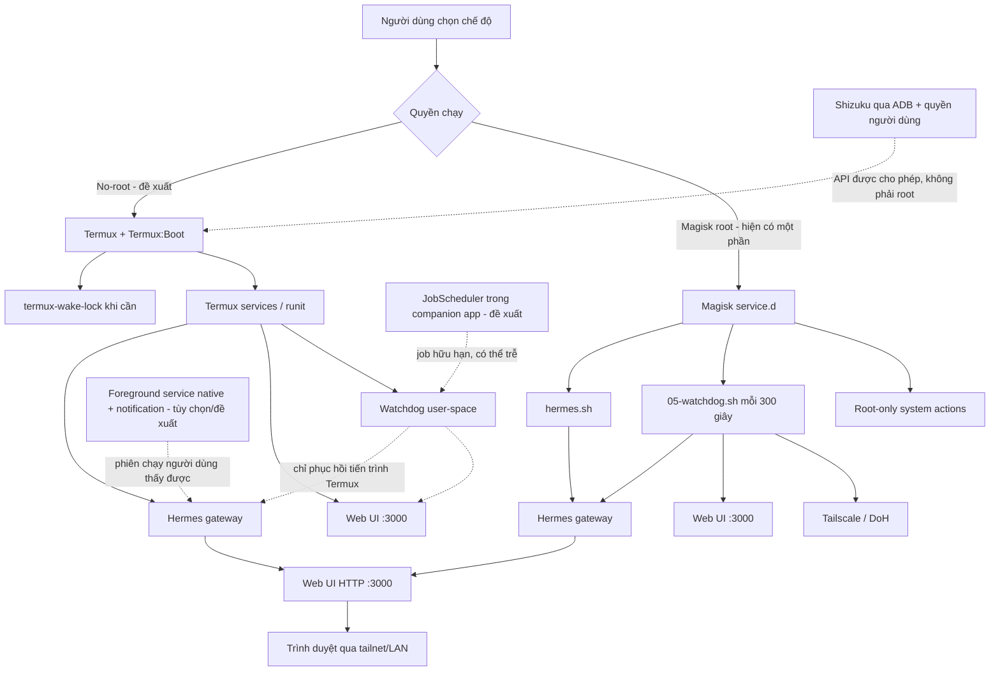

# Kiến trúc runtime: No-Root và Magisk Root

Tài liệu này phân biệt **hành vi đã kiểm tra trong mã nguồn tại base `2f19530`**, **thiết kế đề xuất chưa triển khai trong repo**, và **giới hạn do Android đặt ra**. “No-root” ở đây có nghĩa là Termux chạy bằng quyền ứng dụng thông thường; Shizuku nếu dùng theo nhánh này được khởi chạy bằng ADB/wireless debugging, không phải bằng `su`.

## Tóm tắt

| Chế độ | Khởi động và giám sát hiện có | Đường đề xuất | Quyền và độ tin cậy |
|---|---|---|---|
| Termux, no-root | Installer bỏ qua `service.d`; repo chưa cài Termux:Boot hay watchdog Termux. | Termux:Boot khởi chạy scripts; `termux-services`/runit giám sát tiến trình; dùng WakeLock có giới hạn và thông báo trạng thái. JobScheduler chỉ là cơ chế phục hồi nền bổ trợ nếu có app Android native. | Không có quyền root. Android/OEM vẫn có thể trì hoãn hoặc dừng tác vụ; không hứa 24/7 tuyệt đối. |
| Magisk, root | Installer chép scripts vào `/data/adb/service.d`; `hermes.sh` khởi động gateway và `05-watchdog.sh` giám sát các tiến trình. | Giữ `service.d` cho việc khởi động và các thao tác cần root; làm rõ từng thao tác đặc quyền, thêm health checks có thể quan sát được. | Script chạy trong ngữ cảnh Magisk/root. Quyền mạnh hơn, rủi ro cao hơn; vẫn không bảo đảm tránh mọi sự cố phần cứng, nhiệt, RAM hay mạng. |

Web UI dùng chung ở mức thiết kế. Mã hiện có mặc định port **3000**, nhưng cấu hình Termux thuần chưa hoàn chỉnh và server mặc định bind `0.0.0.0` mà không có xác thực.

## Hành vi đã xác minh trong repo

- [`install.sh`](../install.sh) đặt mặc định `HERMES_HOME=/data/local/hermes-home`. Chỉ tạo và chép các script `service.d/*.sh` khi tiến trình cài có UID 0 **và** nhận diện Magisk. Nếu không, installer báo bỏ qua `service.d` và yêu cầu Termux thuần tự chạy `nohup`/watchdog. Installer không tạo `~/.termux/boot/`, không cài Termux:Boot, không cấu hình JobScheduler hoặc notification, và không tích hợp Shizuku.
- [`service.d/hermes.sh`](../service.d/hermes.sh) đợi 20 giây, chạy `preflight_venv.sh`, rồi dùng `nohup` khởi chạy `hermes gateway run`.
- [`service.d/03-nowake.sh`](../service.d/03-nowake.sh) gọi `svc power stayon true`, `dumpsys deviceidle disable` và đặt `stay_on_while_plugged_in=3`. Đây là các lệnh hiện có; chúng **không chứng minh** máy sẽ luôn thức hay mọi OEM sẽ áp dụng hành vi giống nhau.
- [`service.d/05-watchdog.sh`](../service.d/05-watchdog.sh) đợi 60 giây rồi lặp mỗi 300 giây. Nó kiểm tra tiến trình DoH; kiểm tra gateway bằng cả tiến trình lẫn dòng `Connected to Telegram` trong log; nếu điều kiện không đạt thì chạy preflight và khởi động lại gateway. Nó cũng khởi chạy lại Web UI nếu file tồn tại mà tiến trình không chạy, và thử mở ứng dụng Tailscale nếu không thấy tiến trình Tailscale. Đây là watchdog trong nhánh Magisk của repo, không phải watchdog no-root.
- [`service.d/02-adbd.sh`](../service.d/02-adbd.sh) đặt cổng ADB TCP 5555 rồi dừng/khởi động lại `adbd`. Đây là thay đổi đặc quyền; việc bật ADB qua mạng cần được đánh giá và bảo vệ riêng, không coi là yêu cầu mặc định của nhánh no-root.
- [`web/server.py`](../web/server.py) mặc định chạy HTTP trên `0.0.0.0:3000`; [`scripts/webui.sh`](../scripts/webui.sh) mặc định cổng 3000, khởi chạy bằng `nohup`; [`web/README.md`](../web/README.md) ghi rõ UI không có xác thực và không nên mở trực tiếp ra Internet.
- Repo không có Android companion app. Do đó, mọi đề xuất bên dưới về foreground service native hoặc JobScheduler cần một thành phần Android riêng; chưa có mã thực thi các cơ chế này ở base đang xét.

## Thiết kế đề xuất — Termux no-root

**Đề xuất, chưa triển khai:** giữ toàn bộ tiến trình Hermes và Web UI trong không gian Termux, không giả định có quyền điều khiển hệ thống.

1. **Boot:** cài Termux:Boot, mở app này ít nhất một lần theo hướng dẫn chính thức, rồi đặt script khởi chạy trong `~/.termux/boot/`. Termux:Boot thực thi các script theo thứ tự tên; script nên gọi rõ các đường dẫn trong `$PREFIX` và ghi log. Dùng `termux-services`/runit để khai báo gateway và Web UI thành các service người dùng có lệnh start/stop/status, thay vì xem một lệnh `nohup` là cơ chế phục hồi hoàn chỉnh.
2. **Giữ thức và trạng thái:** khi thực sự cần duy trì kết nối dài hạn, service có thể dùng `termux-wake-lock` và phải nhả lock khi dừng; cân nhắc pin và nhiệt. Có thể đưa thông báo trạng thái cho người dùng bằng thành phần phù hợp của Termux/API. Một notification thông thường chỉ báo trạng thái; **không đồng nghĩa** với Android foreground service và tự nó không bảo đảm tiến trình sống.
3. **Foreground service (tùy chọn, cần app native):** nếu sản phẩm cần một dịch vụ dài hạn mà người dùng chủ động bật và có thể theo dõi, thiết kế một Android companion service với notification thường trực, hành động Stop/Status và loại foreground service/permission phù hợp cho phiên bản Android hỗ trợ. Đây là thành phần chưa tồn tại trong repo; cần kiểm tra chính sách khởi chạy foreground service theo API level và OEM trước khi triển khai.
4. **JobScheduler (tùy chọn, cần app native):** dùng `JobService` để làm công việc hữu hạn như health check/recovery sau khi mạng hoặc sạc thay đổi, hoặc sửa trạng thái sau khi tiến trình bị dừng. Không dùng JobScheduler làm đồng hồ watchdog 5 phút hoặc giả định nó giữ một socket Telegram mở liên tục: hệ thống có quyền gom và trì hoãn job. Android thực thi job trong tiến trình/app đã đăng ký `JobService`; shell Termux hiện tại không tự đăng ký một job như vậy.
5. **Watchdog no-root:** supervisor runit hoặc một vòng giám sát user-space được khởi chạy từ Termux:Boot chỉ kiểm tra và khởi động lại các tiến trình thuộc Termux (gateway, Web UI). Có thể dùng cả PID lẫn health check ứng dụng/log như tiêu chí. Không gọi `iptables`, `setprop`, `svc power`, `dumpsys deviceidle disable` hay `su`; nếu không có quyền, báo lỗi rõ và để người dùng quyết định. Đây là phần thiết kế; repo chưa có service/watchdog Termux tương ứng.
6. **Shizuku là cầu quyền tùy chọn:** trong no-root, chỉ dùng phương thức ADB/wireless debugging và chỉ gọi API/quyền mà Shizuku cùng ứng dụng phía client hỗ trợ, sau khi người dùng khởi động Shizuku và cấp quyền. Shizuku không cấp `su`, không biến Termux thành root và không thay thế Magisk `service.d`. Theo hướng dẫn Shizuku, wireless debugging khả dụng từ Android 11+ nhưng cần khởi động lại Shizuku sau mỗi lần reboot do giới hạn hệ thống. Khả năng bắt đầu Shizuku bằng root thuộc nhánh root riêng, không được tính là no-root.

## Thiết kế đề xuất — Magisk root

**Một phần đã có; mục này không phải lời khẳng định về triển khai mới.** Giữ Magisk `service.d` làm entry point cho khởi động sau boot. Tài liệu Magisk gọi `service.d` là general scripts chạy ở `late_start service` (không chặn boot); Magisk khuyến nghị giai đoạn này cho phần lớn boot scripts. Installer hiện cài các file repo vào `/data/adb/service.d` khi xác nhận root + Magisk.

- `hermes.sh` khởi chạy gateway sau khi chờ và chạy preflight.
- `05-watchdog.sh` là watchdog đặc quyền hiện tại; các chu kỳ kiểm tra là 300 giây và có thể phục hồi gateway, DoH, Web UI, Tailscale như mô tả ở phần hành vi đã xác minh.
- Các thay đổi hệ thống (ví dụ ADB TCP, iptables, cài đặt stay-awake/idle) phải nằm riêng trong chế độ root, có mô tả tác dụng và cách tắt/khôi phục. Không dùng những lệnh này làm đường dự phòng âm thầm cho Termux.
- Khi triển khai tiếp, nên coi từng script là một đơn vị có log, trạng thái và giới hạn retry; không coi việc process tồn tại là đủ để khẳng định dịch vụ khỏe. Watchdog hiện đã dùng thêm điều kiện log cho gateway, nhưng các kiểm tra cho Web UI/Tailscale/DoH chủ yếu dựa trên tiến trình.

## Sơ đồ kiến trúc

## Giới hạn nền tảng và bảo mật

- **WakeLock không phải bảo đảm uptime.** Android khuyến nghị tránh giữ wake lock nếu có lựa chọn phù hợp và nhả sớm vì tốn pin. Trong Doze, Android hạn chế mạng và job, đồng thời có thể bỏ qua wake lock. Các ROM/OEM còn có thể áp chính sách pin riêng.
- **JobScheduler không phải timer chính xác.** Android có thể gom hoặc trì hoãn công việc để giảm tác động đến hệ thống; job có giới hạn vận hành và có thể bị dừng. Dùng nó cho công việc có thể trì hoãn/phục hồi, không để hứa giữ kết nối nền liên tục.
- **Foreground service phải minh bạch và đúng mục đích.** Android yêu cầu foreground service phục vụ tác vụ người dùng có thể nhận biết, kèm status notification; còn có giới hạn khởi chạy và yêu cầu theo loại service/API level. Notification thông thường không thay thế các yêu cầu đó.
- **Shizuku không đồng nhất với root.** Shizuku chuyển lời gọi qua service chạy với quyền ADB hoặc root. Với kiến trúc no-root, chỉ xem service khởi chạy bằng ADB và các quyền đã cấp là hợp lệ; quyền đó không tương đương quyền `su` đầy đủ.
- **Web UI hiện không có xác thực/TLS trong code đang kiểm tra.** Mặc định bind `0.0.0.0`, nên có thể nghe trên các interface của máy chứ không chỉ tailnet. Không mở port 3000 trực tiếp ra Internet; giới hạn bằng firewall/Tailscale ACL hoặc proxy có xác thực. Nếu cần chỉ truy cập tailnet, thiết kế phải bind vào địa chỉ Tailscale cụ thể hoặc giới hạn network ở lớp ngoài.
- **Ranh giới tin cậy của service root:** `service.d/hermes.sh` đặt `PATH`, `LD_LIBRARY_PATH` và `LD_PRELOAD` trỏ vào thư mục Termux, rồi chạy helper và virtualenv trong `/data/local/hermes-home` dưới ngữ cảnh Magisk. `install.sh` cũng có đường `git clone --depth 1` cho repo mà không ghim commit hoặc kiểm tra chữ ký/hash. Vì vậy các script, binary, thư viện và nội dung được lấy từ những vị trí này thuộc ranh giới tin cậy của tiến trình root; cần kiểm tra quyền ghi thực tế trên thiết bị trước khi triển khai. **Đề xuất:** hạn chế tối đa mã chạy bằng root, đặt helper đặc quyền ở vị trí do root kiểm soát, và ghim phiên bản/kiểm tra tính toàn vẹn trước khi cài hoặc cập nhật.
- **Không có cam kết “bất tử 24/7”.** Root hay no-root đều chịu ảnh hưởng của reboot, mất điện/mạng, OOM, giới hạn nhiệt, dung lượng và thay đổi từ OEM/Android. Ghi trạng thái và hướng phục hồi rõ ràng thay vì hứa tiến trình không thể bị dừng.

## Nguồn chính thức

- Android Developers: [Background tasks overview](https://developer.android.com/develop/background-work/background-tasks) — chọn giữa tác vụ nền, scheduler và foreground service.
- Android Developers: [JobScheduler API](https://developer.android.com/reference/android/app/job/JobScheduler) — job chạy trong app có `JobService`, hệ thống gom/trì hoãn job và giữ wake lock trong lúc job chạy.
- Android Developers: [Doze and App Standby](https://developer.android.com/training/monitoring-device-state/doze-standby) — Doze hạn chế mạng, hoãn job và bỏ qua wake lock trong các điều kiện nêu trong tài liệu.
- Android Developers: [Keep the device awake](https://developer.android.com/develop/background-work/background-tasks/awake) và [Wake lock best practices](https://developer.android.com/develop/background-work/background-tasks/awake/wakelock) — ưu tiên lựa chọn nhẹ hơn, tránh giữ wake lock lâu.
- Android Developers: [Foreground services overview](https://developer.android.com/develop/background-work/services/foreground-services) — foreground service hiển thị status notification và bị giới hạn cách dùng/khởi chạy.
- Termux: [Termux:Boot](https://github.com/termux/termux-boot) — mở app một lần, tạo `~/.termux/boot/`, chạy scripts theo thứ tự và ví dụ `termux-wake-lock`.
- Termux: [termux-services](https://github.com/termux/termux-services) — supervisor runit và lệnh quản lý service trong Termux.
- Magisk: [Developer Guides — Boot Scripts](https://github.com/topjohnwu/Magisk/blob/master/docs/guides.md#boot-scripts) — phân biệt `post-fs-data` với `late_start`, general scripts ở `/data/adb/service.d` và yêu cầu executable.
- Shizuku: [Introduction](https://shizuku.rikka.app/introduction/) và [User manual: setup](https://shizuku.rikka.app/guide/setup/) — service được khởi động bằng ADB hoặc root; wireless debugging từ Android 11+ cần thao tác lại sau reboot.
