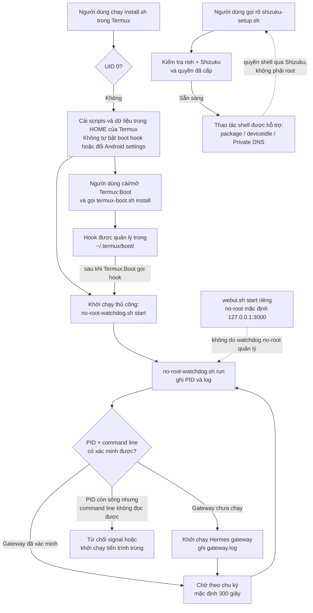
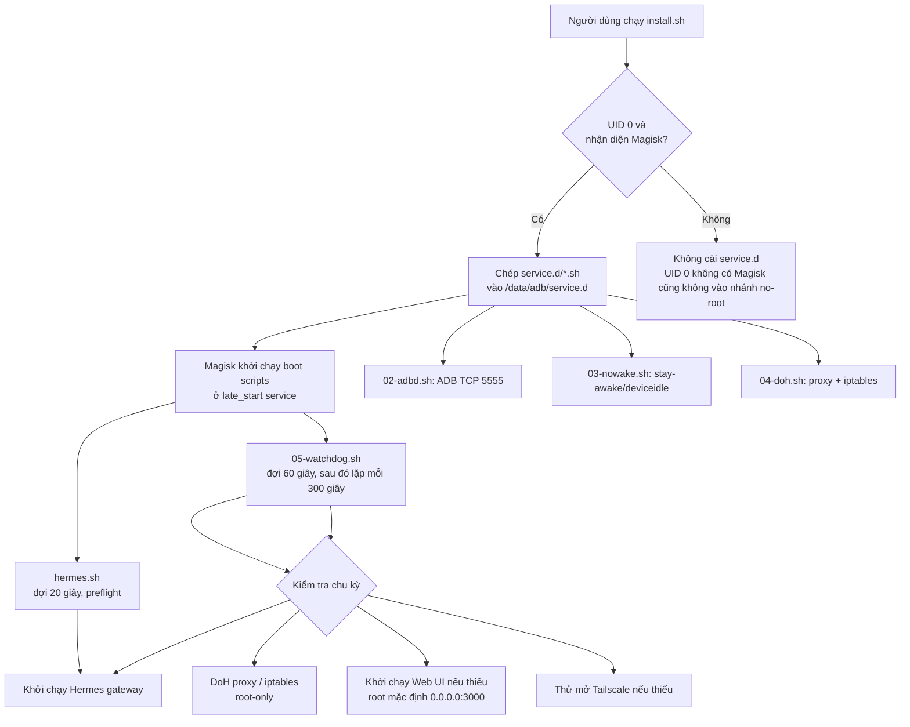

# Kiến trúc runtime Hermes Android V2

Tài liệu này mô tả hành vi có trong mã ở implementation commit `e46da08a417939efe0ee667e0637f99711fa7aff` (so với base `2f19530`), tách biệt với phần đề xuất chưa triển khai. **Hành vi mô tả từ code không đồng nghĩa với việc đã xác nhận trên thiết bị Android. Android runtime chưa được kiểm thử; không có kiểm thử nào trên OnePlus 11R.** Báo cáo kiểm tra shell/harness của implementation là kiểm tra mã/script, không chứng minh boot, quyền Shizuku hay tiến trình nền hoạt động trên thiết bị.

Trong tài liệu này, **no-root** là Termux chạy không có UID 0. Shizuku là cầu gọi một số lệnh ở quyền shell sau khi người dùng khởi chạy và cấp quyền; nó **không phải root**. **Magisk root** là nhánh riêng, trong đó các script `service.d` chạy với quyền mạnh hơn.

## Tóm tắt

| Nhánh | Đã triển khai trong code | Không nên suy diễn thành |
|---|---|---|
| Termux no-root | Installer cài script vào thư mục người dùng; watchdog có thể được khởi chạy thủ công; Termux:Boot hook tùy chọn, chỉ cài khi người dùng gọi lệnh; watchdog chỉ quản lý Hermes gateway của nó. | Tự cài boot hook, watchdog cho mọi dịch vụ, health check kết nối Telegram, hay cam kết tiến trình sống liên tục. |
| Shizuku tùy chọn | CLI `shizuku-setup.sh` kiểm tra `rish` rồi chạy các thao tác package, deviceidle và Android Private DNS khi được gọi rõ ràng. | `su`, quyền root đầy đủ, tự chạy khi boot, hoặc cơ chế DoH/iptables. |
| Magisk root | Installer chép `service.d/*.sh` khi vừa UID 0 vừa nhận diện Magisk. Luồng service.d hiện hữu khởi chạy gateway và có watchdog đặc quyền. | Hành vi no-root; các thay đổi service.d không nằm trong watchdog Termux. |

## V2 đã triển khai

### Cài đặt và phân nhánh quyền

[`install.sh`](../install.sh) nhận diện root từ UID 0 và nhận diện Magisk riêng. Chỉ khi **cả hai** điều kiện đúng, installer mới chép script vào `/data/adb/service.d`. Nếu không, nó bỏ qua `service.d`. Lưu ý: code chọn `MODE=root` theo UID 0; một môi trường UID 0 nhưng không có Magisk vẫn không được cài `service.d` và cũng không đi vào nhánh hướng dẫn `MODE=no-root`.

Mặc định ở Termux không root, `HERMES_HOME` là `$HOME/.hermes-home`, venv là `$HOME/hermes-venv`, và mã `hermes-agent` là `$HOME/hermes-agent`; các đường dẫn này có thể được ghi đè bằng biến môi trường tương ứng. Installer chép script vào `$HERMES_HOME/scripts`, nhưng **không** cài boot hook, không tự gọi watchdog và không thay đổi package, Doze hay DNS hệ thống. Bước khởi chạy no-root được hướng dẫn riêng trong [`docs/NO-ROOT.md`](NO-ROOT.md).

### Termux:Boot và watchdog no-root

[`scripts/termux-boot.sh`](../scripts/termux-boot.sh) chỉ đăng ký boot hook khi người dùng gọi `install`. Hook được đặt tại `$HOME/.termux/boot/hermes-start.sh`; cấu hình đường dẫn được lưu riêng dưới dạng dữ liệu và không được `source`/`eval`. Script từ chối ghi đè hook hoặc file cấu hình không có marker quản lý của Hermes. Lệnh `uninstall` chỉ gỡ các file do Hermes quản lý; nó **không** dừng watchdog hoặc gateway đang chạy. Việc cài/mở Termux:Boot lần đầu là bước ngoài installer.

[`scripts/no-root-watchdog.sh`](../scripts/no-root-watchdog.sh) có thể được gọi thủ công bằng `start`, hoặc được hook Termux:Boot gọi sau reboot. Mặc định nó kiểm tra mỗi 300 giây (giá trị không hợp lệ hoặc nhỏ hơn 10 giây được đưa về 300). Nó xác minh PID và command line trước khi nhận diện hoặc gửi tín hiệu tới tiến trình. Nếu không đọc được command line của PID còn sống, script từ chối gửi tín hiệu hoặc khởi tạo tiến trình trùng.

Watchdog chỉ khởi chạy/giám sát Hermes gateway theo PID mà chính nó ghi nhận. Tiêu chí là danh tính tiến trình, không phải kiểm tra sức khỏe ứng dụng hay trạng thái kết nối Telegram. Nó không giám sát Web UI, Tailscale, DoH, Shizuku, package, deviceidle hay DNS; cũng không gọi `su`, `iptables`, `setprop`, `svc power` hoặc các lệnh hệ thống tương tự. `stop` gửi TERM tới các tiến trình đã xác minh, không phải bằng chứng rằng tiến trình đã dừng trên Android.

### Shizuku helpers (tùy chọn, chạy theo yêu cầu)

[`scripts/shizuku-setup.sh`](../scripts/shizuku-setup.sh) không được installer, boot hook hay watchdog tự gọi. Mỗi nhóm lệnh kiểm tra `rish` và thử `rish -c id`; nếu Shizuku/rish chưa sẵn sàng hoặc chưa được cấp quyền, script dừng.

- `pm show/disable/enable`: thao tác giới hạn ở package bên thứ ba được nêu chính xác; script chỉ nhận quyền hoàn tác package mà chính nó đã disable.
- `deviceidle show/add/remove`: chỉ thêm package bên thứ ba được chỉ định; chỉ gỡ mục mà script đã ghi nhận là do nó thêm. Mục có trước được giữ nguyên.
- `private-dns show/set/restore`: đặt Android Private DNS theo hostname và lưu trạng thái cũ để hoàn tác có điều kiện; nếu thấy cấu hình hiện tại đã bị thay đổi độc lập, script từ chối ghi đè.

Android Private DNS ở đây là **DNS-over-TLS (DoT), không phải DNS-over-HTTPS (DoH)**. Các helper dùng lệnh shell qua Shizuku; chúng không tạo root, không triển khai VPNService/iptables và không được tích hợp vào vòng lặp watchdog. Khả năng hỗ trợ từng lệnh phụ thuộc phiên bản Android/OEM và quyền Shizuku thực tế.

### Magisk `service.d` — luồng hiện hữu, không đổi trong diff V2

Implementation commit không sửa nội dung thư mục `service.d/`; installer giữ luồng cũ và chỉ cài các script đó khi có cả root lẫn Magisk. Theo code hiện có:

- `service.d/hermes.sh` chờ 20 giây, chạy `preflight_venv.sh`, rồi khởi chạy `hermes gateway run`.
- `service.d/05-watchdog.sh` chờ 60 giây rồi lặp theo chu kỳ 300 giây. Nó kiểm tra/chạy lại DoH proxy và quy tắc iptables khi thiếu proxy; kiểm tra gateway theo tiến trình và tìm `Connected to Telegram` trong `/data/local/hermes-home/logs/gateway.log`; chạy lại preflight/khởi động gateway khi điều kiện không đạt; khởi chạy Web UI nếu file server tồn tại mà tiến trình không thấy; và thử mở Tailscale nếu tiến trình không thấy.
- Các helper đặc quyền hiện có còn gồm `02-adbd.sh` (bật ADB TCP 5555), `03-nowake.sh` (các lệnh stay-awake/deviceidle) và `04-doh.sh` (khởi chạy proxy rồi chuyển hướng UDP/53 bằng iptables). Đây **không** phải các hành động của nhánh no-root hay Shizuku helpers.

Có một khác biệt cần giữ rõ khi đọc code: `hermes.sh` chuyển stdout/stderr gateway tới `/data/local/tmp/hermes.log`, trong khi watchdog đọc `logs/gateway.log` để tìm dòng Telegram. Code được đọc không chứng minh hai nguồn log này đồng bộ; cần kiểm chứng thực tế trước khi dựa vào điều kiện log như health check.

### Web UI

[`scripts/webui.sh`](../scripts/webui.sh) mặc định dùng cổng 3000. Ở nhánh không root, host mặc định là `127.0.0.1`; ở nhánh root, mặc định là `0.0.0.0`. Có thể ghi đè bằng `WEBUI_HOST`. Web UI được điều khiển riêng bằng script này; watchdog no-root không tự khởi chạy hay phục hồi nó. Nếu gọi trực tiếp [`web/server.py`](../web/server.py), mặc định riêng của server là `0.0.0.0`.

## Sơ đồ luồng

### Termux no-root, Termux:Boot và Shizuku

### Magisk root và `service.d`

## Đề xuất — chưa triển khai

Các mục dưới đây là hướng thiết kế, không phải hành vi V2 hiện có:

1. **Quản lý service no-root:** cân nhắc `termux-services`/runit để quản lý start/stop/status riêng cho gateway và Web UI. Watchdog V2 hiện chỉ lo gateway; không có tích hợp runit.
2. **Health check tốt hơn:** bổ sung kiểm tra đáp ứng của gateway và log/state có cấu trúc, giới hạn retry và báo lỗi rõ. Không coi process còn tồn tại là bằng chứng dịch vụ khỏe. Phần này chưa được triển khai ở watchdog no-root.
3. **Android companion app (nếu cần):** foreground service có notification thường trực, thao tác Stop/Status và quyền phù hợp có thể là lựa chọn cho tác vụ dài hạn do người dùng nhận biết; `JobScheduler` có thể dùng cho việc hữu hạn như health check hoặc khôi phục sau sự kiện mạng/sạc. Cả hai cần app Android native và chính sách theo API level; repo hiện không có companion app hay mã đăng ký `JobService`. JobScheduler không phải timer chính xác hoặc cơ chế giữ socket liên tục.
4. **Root helper hardening:** giới hạn tối đa lệnh chạy bằng root, ghi rõ thao tác đặc quyền và cách khôi phục, đồng thời xác nhận đường dẫn/permission trên thiết bị. Đây là khuyến nghị, không phải thay đổi trong diff V2.

## Giới hạn nền tảng và bảo mật

- **Android runtime chưa được test.** Harness regression shell 6/6, kiểm tra cú pháp shell và whitespace/diff mà implementation báo cáo chỉ xác minh các trường hợp script/mã tương ứng; chúng không xác nhận hành vi trên Android, chính sách pin của OEM, boot sau reboot hay quyền Shizuku trên một máy cụ thể. Không có kết quả PASS cho Android runtime.
- **Không đảm bảo uptime 24/7.** Termux:Boot cần được cài/mở và hook được đăng ký chủ động. Android/OEM vẫn có thể giới hạn nền, trì hoãn mạng hoặc dừng tiến trình; mất nguồn/mạng, OOM và nhiệt cũng nằm ngoài bảo đảm script.
- **Shizuku không phải root.** Nhánh no-root chỉ dùng quyền shell mà người dùng cấp qua Shizuku; cần khởi động/cấp quyền theo cơ chế Shizuku. Các thao tác deviceidle và Private DNS có thể khác nhau theo Android/OEM; code có nhánh lỗi nhưng chưa được xác minh trên runtime.
- **Web UI cần được giới hạn mạng.** Server không có xác thực/TLS trong code đang xem. Wrapper no-root mặc định loopback, nhưng có thể đổi bằng `WEBUI_HOST`; wrapper root và `web/server.py` mặc định bind `0.0.0.0`. Không mở cổng 3000 ra Internet nếu chưa đặt lớp bảo vệ phù hợp.
- **Magisk scripts có tác động đặc quyền.** ADB TCP, thay đổi deviceidle/stay-awake và iptables là hành vi root hiện có. Không dùng chúng như fallback ngầm cho Termux no-root hoặc Shizuku.
- **Rủi ro preflight với lock không tin cậy:** rà soát tĩnh độc lập tái hiện được việc entry giả trong lock làm `scripts/preflight_venv.sh` chèn dữ liệu vào mã Python `-c` ở dòng 49. Nếu bên ít quyền có thể sửa lock mà tiến trình root đọc, dữ liệu đó có thể chạy mã trong quyền của caller; quyền sở hữu/ghi file trên thiết bị chưa được xác minh. Không chạy root preflight với lock không tin cậy hoặc có thể bị tài khoản khác sửa cho tới khi cách nội suy được xử lý an toàn.

## Nguồn

### Mã nguồn trong repo

- [`install.sh`](../install.sh) — phát hiện UID/Magisk, vị trí cài và điều kiện cài `service.d`.
- [`scripts/termux-boot.sh`](../scripts/termux-boot.sh) — đăng ký/gỡ hook Termux:Boot.
- [`scripts/no-root-watchdog.sh`](../scripts/no-root-watchdog.sh) — vòng giám sát gateway no-root.
- [`scripts/shizuku-setup.sh`](../scripts/shizuku-setup.sh) — helper Shizuku và hoàn tác trạng thái.
- [`scripts/webui.sh`](../scripts/webui.sh), [`web/server.py`](../web/server.py) — host/port mặc định của Web UI.
- [`service.d/`](../service.d/) — luồng Magisk root hiện hữu; thư mục này không thay đổi trong implementation commit được mô tả.
- [`docs/NO-ROOT.md`](NO-ROOT.md) — hướng dẫn sử dụng no-root và các lệnh tùy chọn.

### Tài liệu nền tảng

- Android Developers: [Background tasks overview](https://developer.android.com/develop/background-work/background-tasks), [JobScheduler API](https://developer.android.com/reference/android/app/job/JobScheduler), [Doze and App Standby](https://developer.android.com/training/monitoring-device-state/doze-standby), [Keep the device awake](https://developer.android.com/develop/background-work/background-tasks/awake), [Foreground services overview](https://developer.android.com/develop/background-work/services/foreground-services).
- Termux: [Termux:Boot](https://github.com/termux/termux-boot) and [termux-services](https://github.com/termux/termux-services).
- Magisk: [Developer Guides — Boot Scripts](https://github.com/topjohnwu/Magisk/blob/master/docs/guides.md#boot-scripts).
- Shizuku: [Introduction](https://shizuku.rikka.app/introduction/) and [User manual: setup](https://shizuku.rikka.app/guide/setup/).
